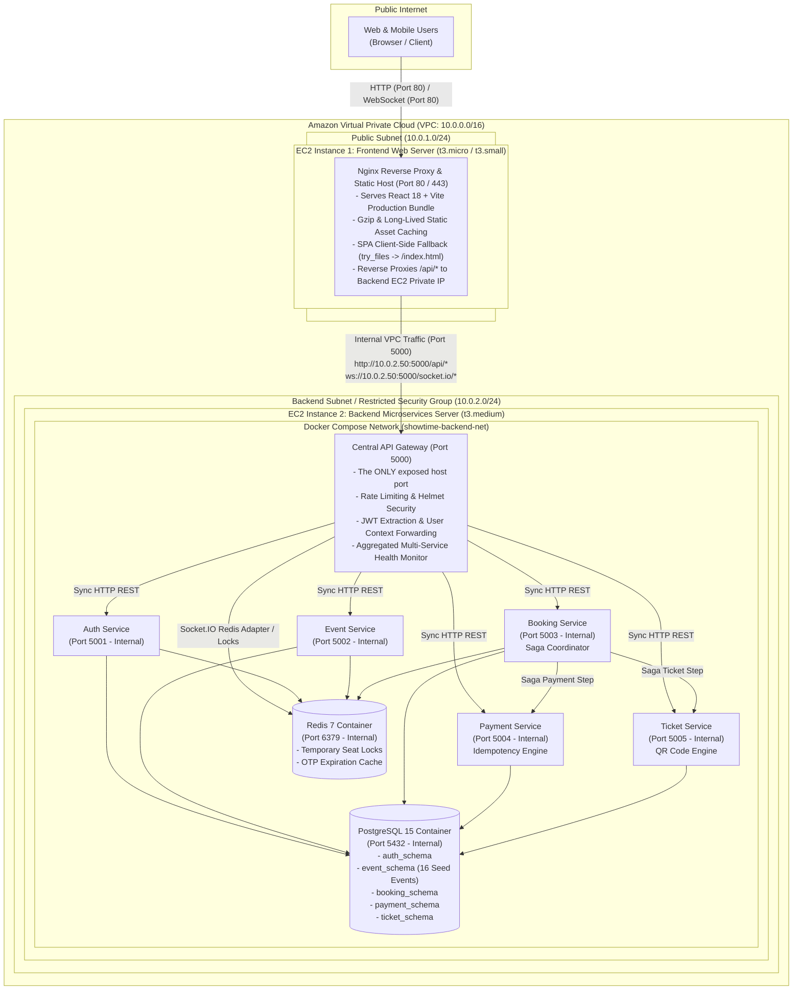

# ShowTime: AWS Cloud Architecture Specification (Two-EC2 Deployment)

This document details the practical, cost-effective **Two-EC2 Demonstration Architecture** for ShowTime, designed specifically for academic evaluation, cloud computing demonstrations, and production-like microservices operations without incurring high AWS infrastructure costs (e.g. NAT Gateways, Multi-AZ RDS, or ALBs).

---

## 1. High-Level Two-EC2 Architecture Diagram

---

## 2. Component Breakdown & Server Roles

### EC2 Instance 1: Frontend Web Server
* **Subnet**: Public Subnet (e.g. `10.0.1.0/24`) with an Elastic IP or public DNS.
* **Instance Type**: `t3.micro` or `t3.small` (Amazon Linux 2023 or Ubuntu 24.04).
* **Role**:
  - Runs Docker with `nginx:alpine` via [`docker-compose.frontend.yml`](file:///c:/Users/Sadvi/Downloads/AWS_CC-main/AWS_CC-main/docker-compose.frontend.yml).
  - Hosts the pre-built React 18 production bundle (`dist/`).
  - Implements SPA client-side routing fallback so direct URLs (e.g. `/event/e001` or `/seats/e001`) never return 404.
  - Dynamically substitutes `BACKEND_API_URL` into Nginx configuration using Nginx's native `envsubst` template support.
  - Reverse proxies all `/api/*` traffic to the Backend EC2 private IP (`http://<BACKEND_PRIVATE_IP>:5000/api/`).

### EC2 Instance 2: Backend Application Server
* **Subnet**: Private Subnet or restricted subnet (`10.0.2.0/24`) within the same VPC.
* **Instance Type**: `t3.medium` (2 vCPUs, 4 GB RAM recommended for multi-container Docker compose).
* **Role**:
  - Runs the full backend microservices suite via [`docker-compose.backend.yml`](file:///c:/Users/Sadvi/Downloads/AWS_CC-main/AWS_CC-main/docker-compose.backend.yml).
  - **Single Exposed Port**: ONLY Port `5000` (API Gateway) is published to the host.
  - PostgreSQL (`5432`), Redis (`6379`), and internal microservices (`5001`-`5005`) are completely unexposed to the host and communicate exclusively over the private Docker bridge network (`showtime-backend-net`).
  - Multi-schema PostgreSQL container stores isolated data for all 5 services with automated seed initialization.

---

## 3. Communication Paradigm: Synchronous HTTP REST Saga

In this deployment, all inter-service communication is **Synchronous HTTP REST**:

1. **Client to Frontend**: Browser requests pages and assets via HTTP/HTTPS.
2. **Frontend to API Gateway**: Nginx proxies API calls to `http://<BACKEND_PRIVATE_IP>:5000/api/*`.
3. **API Gateway to Services**: Gateway extracts and validates JWT tokens, injects `x-user-id` context headers, and forwards requests to the appropriate service container via Docker internal DNS.
4. **Booking Saga Coordination**:
   - The Booking Service coordinates transactions synchronously over HTTP.
   - **Step 1**: Acquires distributed temporary seat locks in Redis (`SET ... EX 300 NX`).
   - **Step 2**: Inserts pending booking in PostgreSQL with seats in `HELD` status.
   - **Step 3**: Synchronously calls Payment Service (`POST http://payment-service:5004/api/payments/process`).
   - **Step 4 (On Payment Success)**: Confirms booking status to `CONFIRMED`, calls Ticket Service (`POST http://ticket-service:5005/api/tickets/generate`) to create scannable QR ticket, releases temporary locks.
   - **Step 4 (On Payment Failure)**: Compensating transaction executes immediately: flips booking status to `CANCELLED`, marks seats as `RELEASED`, releases Redis locks, and rejects the client request with HTTP 402. Zero tickets are issued.

> [!NOTE]
> Synchronous HTTP was deliberately selected over message brokers (e.g., RabbitMQ, SQS, or Kafka) to ensure zero operational complexity, instant student demonstration turnaround, and low memory consumption on a single `t3.medium` instance.

---

## 4. Security Group Configurations

### Frontend Security Group (`sg-showtime-frontend`)
| Type | Protocol | Port Range | Source | Description |
|---|---|---|---|---|
| Inbound | TCP | 80 | `0.0.0.0/0` | Public HTTP traffic from browser clients |
| Inbound | TCP | 443 | `0.0.0.0/0` | Public HTTPS traffic (if TLS enabled) |
| Inbound | TCP | 22 | `ADMIN_IP/32` | SSH administration access |
| Outbound | All | All | `0.0.0.0/0` | Allow outbound traffic (including to backend EC2) |

### Backend Security Group (`sg-showtime-backend`)
| Type | Protocol | Port Range | Source | Description |
|---|---|---|---|---|
| Inbound | TCP | 5000 | `sg-showtime-frontend` | **API Gateway ONLY**: Accepts traffic exclusively from Frontend SG |
| Inbound | TCP | 22 | `ADMIN_IP/32` | SSH administration access |
| Outbound | All | All | `0.0.0.0/0` | Package updates & Docker image pulls |

> [!IMPORTANT]
> Neither PostgreSQL (`5432`), Redis (`6379`), nor the internal microservice ports (`5001`-`5005`) are accessible from outside the Backend EC2 instance. All internal services communicate strictly via container network virtualization.
