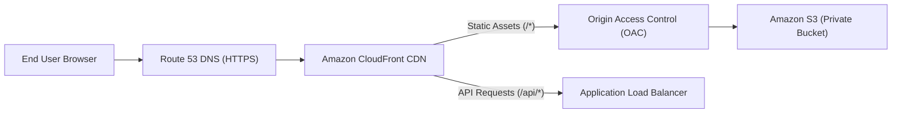

# ShowTime: Frontend Production Deployment Guide (Amazon S3 & CloudFront)

This guide provides instructions to build, optimize, and deploy the React 18 + Vite frontend for ShowTime onto Amazon S3 with Amazon CloudFront global distribution.

---

## 1. Architecture Overview



- **Amazon S3**: Acts as a secure, durable, private object store for compiled HTML, CSS, JavaScript chunks, and event poster images.
- **Origin Access Control (OAC)**: Blocks all direct public access to S3. Only requests routed through CloudFront are signed and authorized.
- **CloudFront CDN**: Provides low-latency edge caching worldwide, terminates TLS/SSL with free AWS ACM certificates, and automatically compresses assets via gzip and Brotli.

---

## 2. Environment Configuration

The frontend uses Vite's environment variable system (`VITE_API_BASE_URL`).

### Local Development (`.env.development`)
```ini
VITE_API_BASE_URL=/api
```
Requests to `/api/*` are automatically proxied to `http://localhost:5000` via Vite's development proxy configured in `vite.config.js`.

### Production (`.env.production`)
When CloudFront handles unified routing (`/*` to S3, `/api/*` to ALB):
```ini
VITE_API_BASE_URL=/api
```
If your backend is hosted on a separate custom subdomain:
```ini
VITE_API_BASE_URL=https://api.yourdomain.com/api
```

> **Security Rule**: Never place database credentials, AWS access keys, or secret tokens into frontend `.env` files. Only prefix public variables with `VITE_`.

---

## 3. Production Build Process

Run the production build from `frontend/showtime`:

```bash
cd frontend/showtime
npm install
npm run build
```

### Build Optimizations Configured in `vite.config.js`:
- **Code Splitting**: Dedicated vendor chunks for `react`, `framer-motion`, and `qrcode`.
- **Hashed Assets**: Every JavaScript and CSS chunk receives a content-based SHA-256 hash (e.g. `vendor-react-DKfBBvw9.js`).
- **Asset Directory**: Build output cleanly structured into `dist/assets/`, `dist/images/`, and `dist/index.html`.

---

## 4. Amazon S3 Bucket Creation & Hardening

Run using AWS CLI (replace `<account-id>` with your AWS Account ID):

```bash
# 1. Create S3 Bucket (Region us-east-1)
aws s3api create-bucket \
  --bucket showtime-frontend-<account-id> \
  --region us-east-1

# 2. Enable S3 Bucket Versioning for easy rollbacks
aws s3api put-bucket-versioning \
  --bucket showtime-frontend-<account-id> \
  --versioning-configuration Status=Enabled

# 3. Block All Public Access (100% Private - Enforce CloudFront OAC)
aws s3api put-public-access-block \
  --bucket showtime-frontend-<account-id> \
  --public-access-block-configuration \
    "BlockPublicAcls=true,IgnorePublicAcls=true,BlockPublicPolicy=true,RestrictPublicBuckets=true"
```

---

## 5. Amazon CloudFront Distribution Setup

### Step 1: Create Origin Access Control (OAC)
```bash
aws cloudfront create-origin-access-control \
  --origin-access-control-config \
  '{"Name": "showtime-s3-oac", "Description": "ShowTime S3 OAC", "SigningProtocol": "sigv4", "SigningBehavior": "always", "OriginAccessControlOriginType": "s3"}'
```

### Step 2: Configure S3 Bucket Policy
Grant CloudFront distribution read access to the S3 bucket:

```json
{
  "Version": "2012-10-17",
  "Statement": [
    {
      "Sid": "AllowCloudFrontServicePrincipalReadOnly",
      "Effect": "Allow",
      "Principal": {
        "Service": "cloudfront.amazonaws.com"
      },
      "Action": "s3:GetObject",
      "Resource": "arn:aws:s3:::showtime-frontend-<account-id>/*",
      "Condition": {
        "StringEquals": {
          "AWS:SourceArn": "arn:aws:cloudfront::<account-id>:distribution/<distribution-id>"
        }
      }
    }
  ]
}
```

Apply the policy:
```bash
aws s3api put-bucket-policy \
  --bucket showtime-frontend-<account-id> \
  --policy file://s3-bucket-policy.json
```

---

## 6. Single Page Application (SPA) Routing & CloudFront Custom Error Response

Because ShowTime uses React Router with HTML5 pushState direct navigation (`/events`, `/event/:id`, `/seats/:id`, `/checkout/:id`, `/my-tickets`), direct page refreshes would otherwise return S3 HTTP 404 or 403.

### Solution: Configure CloudFront Custom Error Responses
In your CloudFront Distribution Settings -> **Error Pages**:

1. **HTTP Error Code 403**:
   - Customize Error Response: **Yes**
   - Response Page Path: `/index.html`
   - HTTP Response Code: **200: OK**
   - Error Caching Minimum TTL: **0**
2. **HTTP Error Code 404**:
   - Customize Error Response: **Yes**
   - Response Page Path: `/index.html`
   - HTTP Response Code: **200: OK**
   - Error Caching Minimum TTL: **0**

---

## 7. Automated S3 Deployment Script with Optimized Caching Headers

Deploy the compiled `dist/` directory using tailored `Cache-Control` headers:

```bash
# 1. Upload Hashed JavaScript, CSS, and QR libraries with Long-Lived Immutable Cache (1 Year)
aws s3 sync dist/assets/ s3://showtime-frontend-<account-id>/assets/ \
  --cache-control "public, max-age=31536000, immutable" \
  --delete

# 2. Upload Static Event Poster Images (1 Day Cache)
aws s3 sync dist/images/ s3://showtime-frontend-<account-id>/images/ \
  --cache-control "public, max-age=86400" \
  --delete

# 3. Upload index.html with NO-CACHE (Forces browser to check for new bundle hashes on every load)
aws s3 cp dist/index.html s3://showtime-frontend-<account-id>/index.html \
  --cache-control "no-cache, no-store, must-revalidate"

# 4. Invalidate CloudFront Edge Cache
aws cloudfront create-invalidation \
  --distribution-id <YOUR_CLOUDFRONT_DISTRIBUTION_ID> \
  --paths "/*"
```

---

## 8. Verification Steps

1. Visit your CloudFront domain (e.g. `https://d123456abcdef8.cloudfront.net`).
2. Verify that the splash screen plays and smoothly transitions to the events explore page.
3. Test direct navigation by entering `https://d123456abcdef8.cloudfront.net/events` in the address bar and pressing refresh. Verify that the page loads without 404 errors.
4. Open Chrome DevTools -> Network Tab. Verify that assets load with status `200 (from disk cache)` or CloudFront `X-Cache: Hit from cloudfront`.
