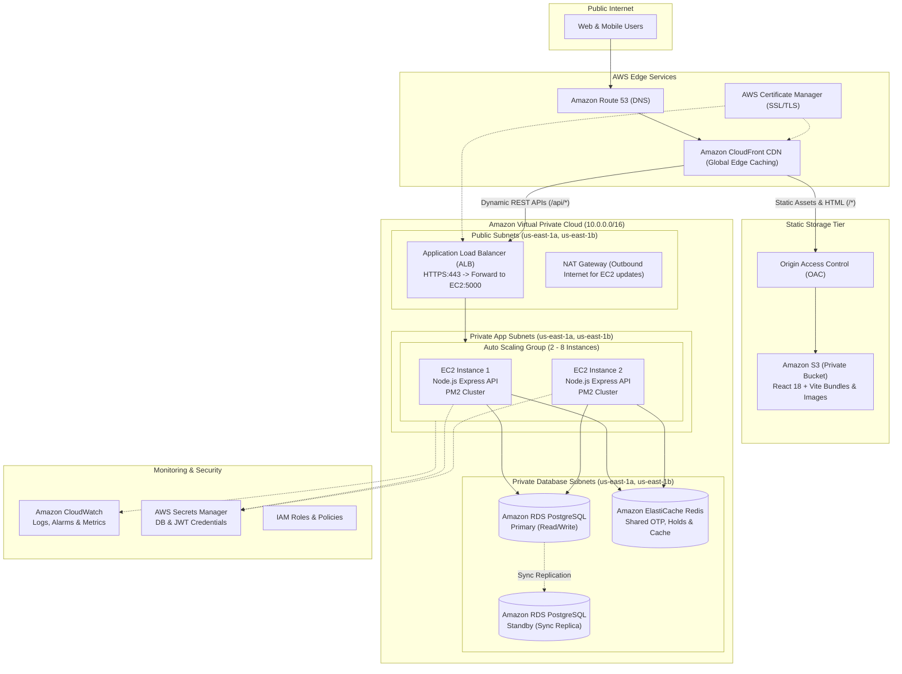

# ShowTime: AWS Cloud Architecture Specification

This document details the target AWS cloud architecture for ShowTime, covering network topology, high availability, stateless compute scaling, database persistence, caching, and disaster recovery.

---

## 1. High-Level Architecture Diagram

---

## 2. Request Routing & Data Flow

### Path 1: Static Web App & Asset Delivery (`GET /*`)
1. User requests `https://showtime.yourdomain.com`.
2. Route 53 resolves the domain to the nearest CloudFront edge location.
3. CloudFront checks its edge cache:
   - If cached (e.g. hashed JS/CSS chunk), returns immediately with zero origin latency.
   - If not cached, signs the request using **Origin Access Control (SigV4)** and pulls from Amazon S3.
4. If a user navigates directly to a client-side route (e.g. `/events` or `/seats/e001`), CloudFront's custom error response maps 404/403 to `/index.html` with HTTP 200, allowing React Router to render the page cleanly.

### Path 2: Dynamic API & Booking Flow (`GET / POST /api/*`)
1. User performs an action (e.g. searches events, logs in, or clicks "Pay & Confirm").
2. CloudFront identifies the path pattern `/api/*` and routes the request to the **Application Load Balancer (ALB)** origin.
3. The ALB terminates TLS and forwards HTTP requests to healthy EC2 backend instances on port 5000 based on least-outstanding requests.
4. The Node.js Express process:
   - Validates the incoming payload and verifies JWT tokens.
   - Consults **ElastiCache Redis** for cached event data, active OTPs, or temporary seat holds.
   - Executes atomic transactions against **Amazon RDS PostgreSQL** (Multi-AZ) to confirm bookings and enforce unique seat constraints.
5. Returns a structured JSON response back through ALB and CloudFront to the user.

---

## 3. High Availability & Disaster Recovery (DR)

| Failure Scenario | Automatic Recovery Mechanism | RTO (Recovery Time) | RPO (Data Loss) |
| :--- | :--- | :--- | :--- |
| **EC2 Instance Crash** | ASG health check detects failure via `/api/health`, terminates instance, launches replacement | < 2 minutes | 0 (Stateless backend) |
| **Availability Zone (AZ) Outage** | ALB routes traffic exclusively to healthy AZ; ASG scales instances in surviving AZ | < 30 seconds | 0 |
| **Primary RDS Database Failure** | RDS Multi-AZ automatically fails over to synchronous standby replica; DNS flips | < 60 seconds | 0 (Synchronous replication) |
| **Redis Cache Node Failure** | ElastiCache promotes replica; backend seamlessly falls back to DB source of truth | < 30 seconds | 0 |
| **S3 Region Outage** | CloudFront serves cached assets from global edge locations | Instant | 0 |

---

## 4. Scalability Metrics & Capacity Planning

- **Frontend**: S3 and CloudFront scale automatically to handle millions of requests without manual provisioning.
- **Backend**: Auto Scaling Group uses Target Tracking on CPU utilization (threshold 70%). Can handle thousands of requests per second by autoscaling from 2 to 8 `t4g.small` instances.
- **Database**: Connection pooling capped at 20 per instance. RDS gp3 storage autoscales dynamically from 50 GB up to 500 GB.

