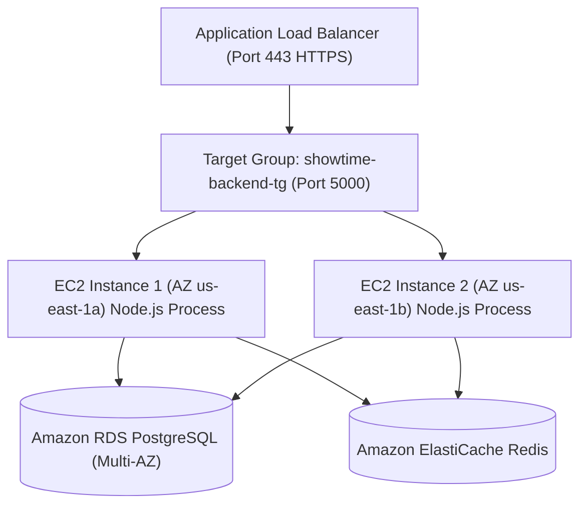

# ShowTime: Backend Production Deployment Guide (Amazon EC2, ALB & Auto Scaling)

This guide provides instructions to deploy the modernized Node.js and Express backend of ShowTime across a scalable, high-availability cluster on Amazon EC2 fronted by an Application Load Balancer (ALB).

---

## 1. High Availability Architecture



### Stateless Design Principles:
1. **Zero Local File Dependency**: Persistent data resides in PostgreSQL; shared temporary state (OTPs, rate-limits, seat holds) resides in Redis.
2. **Horizontal Scalability**: EC2 instances can be dynamically launched or terminated by Auto Scaling without session disruption.
3. **Graceful Shutdown**: The server listens for `SIGTERM` and `SIGINT`, finishes active HTTP requests, and safely drains connection pools.

---

## 2. Server Environment Setup & PM2 Process Manager

We recommend running Node.js under **PM2** process manager to manage clustering, automatic restarts on failure, and seamless log rotation.

### Production `ecosystem.config.cjs`:
Save as `backend/ecosystem.config.cjs`:
```javascript
module.exports = {
  apps: [
    {
      name: "showtime-api",
      script: "./server.js",
      instances: "max",       // Spawns worker process per CPU core
      exec_mode: "cluster",
      watch: false,
      max_memory_restart: "800M",
      env_production: {
        NODE_ENV: "production",
        PORT: 5000,
      },
    },
  ],
};
```

---

## 3. EC2 Launch Template & User Data Script

Create a Launch Template named `showtime-backend-lt`.

### Instance Configuration:
- **AMI**: Amazon Linux 2023 (64-bit x86 or ARM64)
- **Instance Type**: `t4g.small` (ARM Graviton3, cost-efficient) or `t3.small`
- **IAM Role**: `ShowTime-EC2-Role` (grants access to AWS Systems Manager & Secrets Manager)
- **Security Group**: `sg-showtime-ec2` (allows inbound port 5000 strictly from ALB security group)

### Launch Template User Data Script:
```bash
#!/bin/bash
set -e

# 1. Update OS and install Node.js 20 LTS & Git
dnf update -y
dnf install -y git
curl -fsSL https://rpm.nodesource.com/setup_20.x | bash -
dnf install -y nodejs
npm install -g pm2

# 2. Setup Application Directory
mkdir -p /opt/showtime
cd /opt/showtime

# 3. Clone Repository or pull deployment artifact
# Replace with your repository or S3 code bundle
git clone https://github.com/your-org/AWS_CC.git .
cd backend

# 4. Fetch Secrets from AWS Secrets Manager
export AWS_DEFAULT_REGION="us-east-1"
SECRETS=$(aws secretsmanager get-secret-value --secret-id showtime/production/backend --query SecretString --output text)

# Write .env file
echo "NODE_ENV=production" > .env
echo "PORT=5000" >> .env
echo "HOST=0.0.0.0" >> .env
echo "$SECRETS" | jq -r 'to_entries|map("\(.key)=\(.value|tostring)")|.[]' >> .env

# 5. Install Dependencies & Build
npm ci --omit=dev

# 6. Start Application via PM2
pm2 start ecosystem.config.cjs --env production
pm2 save
pm2 startup systemd -u ec2-user --hp /home/ec2-user
```

---

## 4. Application Load Balancer (ALB) Configuration

### Step 1: Create Target Group
```bash
aws elbv2 create-target-group \
  --name showtime-backend-tg \
  --protocol HTTP \
  --port 5000 \
  --vpc-id <VPC-ID> \
  --target-type instance \
  --health-check-protocol HTTP \
  --health-check-path /api/health \
  --health-check-interval-seconds 15 \
  --health-check-timeout-seconds 5 \
  --healthy-threshold-count 2 \
  --unhealthy-threshold-count 3 \
  --matcher HttpCode=200
```

### Step 2: Create Application Load Balancer
```bash
aws elbv2 create-load-balancer \
  --name showtime-alb \
  --subnets <PUBLIC-SUBNET-1> <PUBLIC-SUBNET-2> \
  --security-groups <SG-ALB-ID> \
  --scheme internet-facing \
  --type application
```

### Step 3: Create HTTPS Listener
```bash
aws elbv2 create-listener \
  --load-balancer-arn <ALB-ARN> \
  --protocol HTTPS \
  --port 443 \
  --certificates CertificateArn=<ACM-CERTIFICATE-ARN> \
  --default-actions Type=forward,TargetGroupArn=<TARGET-GROUP-ARN>
```

---

## 5. Auto Scaling Group (ASG) Setup

Create an Auto Scaling Group across your private subnets:

```bash
aws autoscaling create-auto-scaling-group \
  --auto-scaling-group-name showtime-asg \
  --launch-template LaunchTemplateName=showtime-backend-lt,Version='$Latest' \
  --min-size 2 \
  --max-size 8 \
  --desired-capacity 2 \
  --target-group-arns <TARGET-GROUP-ARN> \
  --vpc-zone-identifier "<PRIVATE-SUBNET-1>,<PRIVATE-SUBNET-2>" \
  --health-check-type ELB \
  --health-check-grace-period 120
```

### Scaling Policy (CPU Utilization Tracking):
```bash
aws autoscaling put-scaling-policy \
  --auto-scaling-group-name showtime-asg \
  --policy-name cpu70-target-tracking \
  --policy-type TargetTrackingScaling \
  --target-tracking-configuration file://scaling-policy.json
```
Where `scaling-policy.json` contains:
```json
{
  "TargetValue": 70.0,
  "PredefinedMetricSpecification": {
    "PredefinedMetricType": "ASGAverageCPUUtilization"
  },
  "ScaleOutCooldown": 60,
  "ScaleInCooldown": 300
}
```

---

## 6. Zero-Downtime Rolling Update Procedure

When updating the backend application:

1. Update the Launch Template with the new commit/AMI tag:
   ```bash
   aws ec2 create-launch-template-version \
     --launch-template-name showtime-backend-lt \
     --source-version '$Latest' \
     --launch-template-data '...'
   ```
2. Trigger an ASG Instance Refresh:
   ```bash
   aws autoscaling start-instance-refresh \
     --auto-scaling-group-name showtime-asg \
     --preferences '{"MinHealthyPercentage": 50, "InstanceWarmup": 120}'
   ```
3. AWS will automatically terminate one old instance at a time after the new instance passes the `/api/health` check, ensuring zero user downtime.

