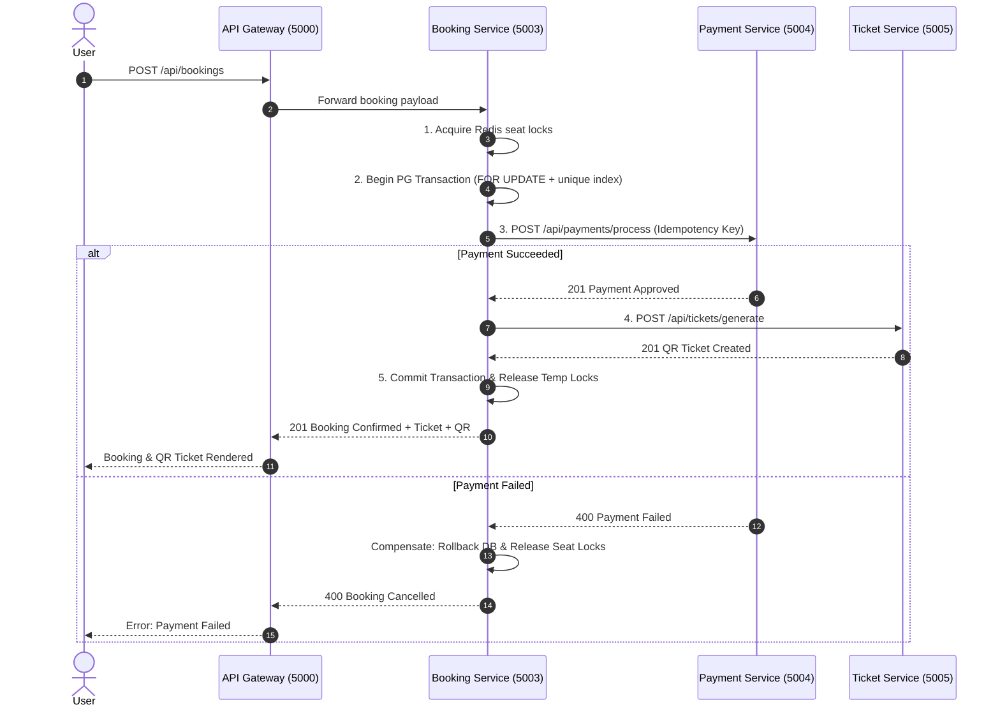

# ShowTime Microservices Architecture & AWS Cloud Reference

## 1. System Overview

ShowTime has been transitioned from a monolithic architecture into a scalable, production-oriented **Microservices Architecture**.

```
                           +------------------------+
                           |  React 18 Frontend     |
                           |  (S3 + CloudFront CDN) |
                           +-----------+------------+
                                       |
                                       v
                           +------------------------+
                           |   API Gateway (5000)   |
                           |  (Rate Limit, JWT, ALB)|
                           +----+---+---+---+---+---+
                                |   |   |   |   |
         +----------------------+   |   |   |   +----------------------+
         |                          |   |   |                          |
         v                          v   v   v                          v
+------------------+         +--------------+         +------------------+
|  Auth Service    |         |Event Service |         | Ticket Service   |
|  Port: 5001      |         |Port: 5002    |         | Port: 5005       |
|  DB: auth_schema |         |DB: event_sch |         | DB: ticket_schema|
+--------+---------+         +-------+------+         +--------+---------+
         |                           |                         |
         +-----------------+         |         +---------------+
                           |         |         |
                           v         v         v
                     +----------------------------------+
                     |    Booking Service (Port 5003)   |
                     |  - Concurrency Lock (FOR UPDATE) |
                     |  - Unique Partial Index          |
                     |  - Saga Coordinator              |
                     +----------------+-----------------+
                                      |
                                      v
                     +----------------------------------+
                     |    Payment Service (Port 5004)   |
                     |  - Idempotency Key Engine        |
                     |  - Mock Payment Settlement       |
                     +----------------------------------+
```

---

## 2. Service Specifications

| Service | Port | Database Schema | Primary Responsibilities |
|---|---|---|---|
| **API Gateway** | `5000` | None (Stateless) | Unified entry point (`/api/*`), CORS, rate limiting, JWT token verification & propagation, aggregated health check. |
| **Auth Service** | `5001` | `auth_schema` | User registration & login, bcrypt password hashing, JWT issuance & refresh, Redis OTP generation & verification, account lifecycle. |
| **Event Service** | `5002` | `event_schema` | Event catalog CRUD, category/city filtering, show schedule, dynamic seat layout generation, Redis caching. |
| **Booking Service** | `5003` | `booking_schema` | Concurrency-safe seat reservation, distributed Redis locks, row-level locks (`FOR UPDATE`), partial unique constraints, Saga coordination. |
| **Payment Service** | `5004` | `payment_schema` | Mock payment gateway, idempotency key checking to avoid duplicate charges, transaction logging, refunds. |
| **Ticket Service** | `5005` | `ticket_schema` | Scannable QR code generation via `qrcode` library, ticket retrieval, gate scan validation (`USED` state). |

---

## 3. High-Concurrency & Double-Booking Prevention

ShowTime guarantees zero double-booking under extreme high-concurrency loads using a 3-layer protection model:

1. **Distributed Temporary Lock (Redis TTL)**:
   - When a user proceeds to checkout, seats are temporarily locked in Redis via atomic `SET key val EX 300 NX`.
   - If another user attempts to checkout the same seat within 5 minutes, they receive an immediate `409 Conflict`.
2. **PostgreSQL Row-Level Transaction Lock (`SELECT ... FOR UPDATE`)**:
   - Within an atomic PostgreSQL transaction, the Booking Service queries `booking_seats` with `FOR UPDATE`.
   - Any concurrent transaction waiting on the same seat blocks until the primary transaction commits.
3. **Database-Level Unique Partial Index**:
   ```sql
   CREATE UNIQUE INDEX uq_booking_active_seat
   ON booking_schema.booking_seats (event_id, seat_number)
   WHERE reservation_status IN ('HELD', 'CONFIRMED');
   ```
   - Even if concurrent requests bypass application-level checks, PostgreSQL rejects conflicting inserts with error code `23505`.

---

## 4. Distributed Saga Pattern for Booking Execution



---

## 5. Local Orchestration & Running Guide

### Option A: Using Docker Compose (Full Stack)
```bash
# Start all microservices, API gateway, PostgreSQL, Redis, and frontend
docker compose up --build
```
- Frontend: `http://localhost:80`
- API Gateway: `http://localhost:5000`
- Gateway Aggregated Health Check: `http://localhost:5000/api/health`

### Option B: Local Node.js Development Mode
```bash
# Launch all 5 microservices + API gateway simultaneously
npm run start:all

# Run the comprehensive test suite
npm run test:microservices

# Run concurrency double-booking test
npm run test:concurrency
```

